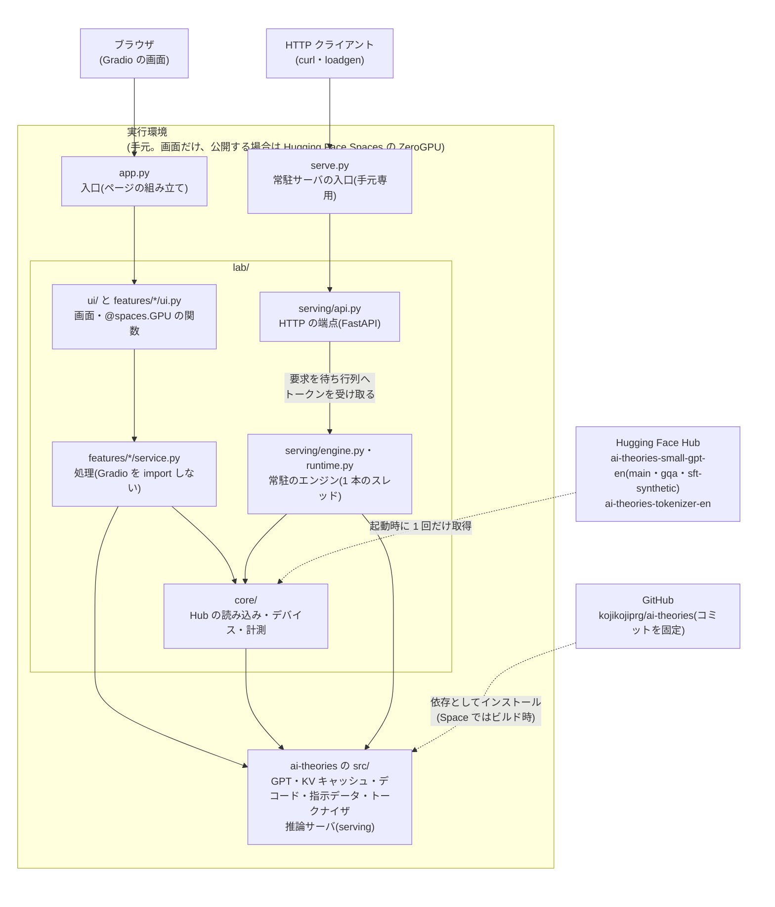

# AI Theories Lab

[ai-theories](https://github.com/kojikojiprg/ai-theories)の`theories/`で学んだ理論を、ブラウザで手を動かして確かめる **1 つの Web アプリ** です。スクラッチ実装した小型 GPT(Generative Pre-trained Transformer、英語、約 524 万パラメータ)を動かして、機能ごとにタブで試します。機能は、対応する理論のトピックが`theories/`にできてから、段階的に足していきます(計画は[`apps/README.md`](https://github.com/kojikojiprg/ai-theories/blob/main/apps/README.md))。Hugging Face Spaces の ZeroGPU で公開できるように作っていますが、**現在は未公開で、ローカルで実行します**(無料のアカウントでは Gradio の Space を作成できなかったため。起動方法は 5.1)。画面とは別に、**手元専用の常駐サーバ(HTTP の API)** もあります(`serve.py`。ZeroGPU とは合わないので、Spaces では動きません)。

- 研究・教育目的のモデルで、品質の保証はありません。ChatGPT のように会話できるモデルではありません。
- モデルが英語で学習しているため、入力は英語です。画面の文言は日本語を主とし、英語を併記しています。

## 1. 概要

現在の機能は、段階 1 の 3 つと、段階 2-1 の 2 つ(バッチ推論のタブと、手元専用の常駐サーバ)です。

| 機能 | できること | 使うモデル(Hub のブランチ) |
|---|---|---|
| 文章の生成 | 英語の書き出しの続きを 1 トークンずつ逐次表示で生成する。デコードの方法(貪欲法・temperature・top-k・top-p・ビームサーチ)とその設定、KV キャッシュの有無、モデル(`main` / `gqa`)を切り替える。生成のたびに、生成したトークン数・時間・毎秒のトークン数を表示する。同じ入力・同じシードで、デコードの方法 2 つを並べて比べられる | `main`(標準の多頭注意機構)、`gqa`(Grouped-Query Attention) |
| モデルの中を見る | 英語の文を入れると、トークン分割(BPE の結合の過程を段階ごとに)・注意の重み(層とヘッドを選ぶ)・トークンごとの確率とエントロピー(位置を選ぶと上位の候補)を表示する | `main` |
| 指示への応答 | 016 の合成課題(英単語の列に対する 4 種類の操作)の指示に答える。見たことのあるテンプレートと未見のテンプレートを選べる。正解は規則で決まるので、完全一致したかを表示する | `sft-synthetic` |
| バッチ推論(段階 2-1) | 合成の負荷(要求の数・出力長の平均と変動係数・一斉または Poisson 過程の到着)を、同じ条件で static batching と continuous batching に流して比べる。最大バッチサイズ・KV キャッシュの管理方式(最大長の分を確保 / PagedAttention)・ブロックの大きさ・予算・共通の system prompt を選べる。表は、**機器によらない量**(反復の回数・無駄な行の割合・要求ごとの待ちの反復数・出力トークンあたりの反復数・KV キャッシュの使用量・退避の回数。スケジューラとメモリ管理だけで決まり、一括の負荷では、機器が変わっても実行ごとに同じ値になる)を先に、**実時間の指標**(スループット・最初のトークンまでの時間(Time To First Token)・出力トークンあたりの時間(Time Per Output Token)・待ち行列の待ち時間。機器に依存するので、ウォームアップの後に同じ負荷を 3 回実行した中央値と(最小〜最大))をその後に、さらに 1 反復の時間の内訳(forward・入力の配置・その他・待ち)と、固定費の割合(1 反復の時間が行数にどれだけ依存するか)を示す。要求ごとの時間の帯と KV キャッシュの使用量の推移を図で示す(図は、全体の時間が中央値の実行)。027 の観察 D(最大バッチサイズを振って、スループットと待ち時間の関係を測る)も実行できる | `main`・`gqa` |
| 常駐サーバと HTTP の API(段階 2-1・手元専用) | 常駐のエンジンが、実行中に届く要求を受け付けて同時に進める(continuous batching または static batching)。`POST /v1/generate`(`stream: true`で Server-Sent Events による逐次表示)・`GET /v1/health`・`GET /v1/stats`。待ち行列の上限(HTTP 429)・要求の時間の上限・切断による取り消し・停止の手順を持つ。負荷を掛ける道具(`lab/serving/loadgen.py`)で、本物の HTTP の同時要求を送って 2 つの方式を比べられる(5.1) | `main`・`gqa` |

## 2. 使用した理論

| トピック | このアプリでの使い方 |
|---|---|
| [001 注意機構](https://github.com/kojikojiprg/ai-theories/blob/main/theories/01_foundations/001_attention_mechanism.ipynb) | 「モデルの中を見る」の注意の重み。各層の注意機構が返す重みを、順伝播の途中で読み取って図にする |
| [005 トークナイザと部分語分割](https://github.com/kojikojiprg/ai-theories/blob/main/theories/02_pretraining/005_tokenizer.ipynb) | 「モデルの中を見る」のトークン分割。バイトレベル BPE が、学習した順位の高いマージ規則から順に語を結合していく過程を、段階ごとに表示する |
| [008 デコーディング戦略](https://github.com/kojikojiprg/ai-theories/blob/main/theories/02_pretraining/008_decoding_strategies.ipynb) | 「文章の生成」のデコードの方法(top-k・top-p のフィルタとビームサーチは`src/generation/decoding.py`のものをそのまま使う)。退化(Degeneration、同じ句の繰り返し)を、貪欲法と top-p を並べて見る。「モデルの中を見る」の、トークンごとの確率とエントロピー。常駐サーバの要求ごとのデコードの設定(貪欲法・temperature・top-k・top-p。ビームサーチは使えない) |
| [010 KV キャッシュと推論の計算量](https://github.com/kojikojiprg/ai-theories/blob/main/theories/03_efficient_training/010_kv_cache_and_inference_compute.ipynb) | 「文章の生成」の KV キャッシュの有無(`src/generation/cache.py`)と、`gqa`ブランチのモデル(Key / Value のヘッド数を減らした Grouped-Query Attention)。貪欲法では KV キャッシュの有無で生成結果が一致する。「バッチ推論」と常駐サーバの、エンジンを通した生成は、010 の 1 要求ずつの生成と一致する(試験の基準) |
| [027 推論サーバ: continuous batching と PagedAttention](https://github.com/kojikojiprg/ai-theories/blob/main/theories/03_efficient_training/027_inference_serving.ipynb) | 「バッチ推論」と常駐サーバのエンジン。スケジューラ(static batching・continuous batching)・KV キャッシュの管理(最大長の確保・PagedAttention のブロック表・接頭辞の共有・書き込み時の複製・退避)・1 回の forward で行ごとに位置の違う要求を進める実行器・合成の負荷・指標・見積もり用の`DryRunner`は、`src/serving/`のものをそのまま使う。最大バッチサイズの既定値 16 は、027 の 7.10 節による |
| [016 SFT(指示チューニング)](https://github.com/kojikojiprg/ai-theories/blob/main/theories/04_alignment/016_supervised_fine_tuning.ipynb) | 「指示への応答」の合成の指示データ(`src/data/instruction.py`)、見たことのあるテンプレートと未見のテンプレート、終端記号までの貪欲法の生成と採点(`src/generation/stopping.py`) |
| [017 報酬モデルと RLHF](https://github.com/kojikojiprg/ai-theories/blob/main/theories/04_alignment/017_reward_model_and_rlhf.ipynb) | 「指示への応答」のモデル。017 が 016 の条件 1 のレシピで SFT し、LoRA をマージして`sft-synthetic`ブランチに上げたもの |

常駐サーバの API の層そのもの(HTTP の端点・待ち行列の上限・取り消し・停止の手順・負荷を掛ける道具)は、システムの仕組みなので、対応する理論トピックはありません。

小型 GPT 本体は [006 小型 GPT の事前学習](https://github.com/kojikojiprg/ai-theories/blob/main/theories/02_pretraining/006_pretraining_small_gpt.ipynb) と [008](https://github.com/kojikojiprg/ai-theories/blob/main/theories/02_pretraining/008_decoding_strategies.ipynb) で事前学習したものです。

## 3. システム構成図



起動時に、トークナイザと 3 ブランチのモデルを同時にメモリへ載せます(重みの合計は約 59 MiB で、GPU のメモリにも余裕で載ります)。生成などの要求のたびに、ZeroGPU 上では、`@spaces.GPU`を付けた関数の中で GPU が割り当てられ、終わると解放されます。手元(現在の実行方法)では、`@spaces.GPU`は何もせず、CUDA → MPS → CPU の順に選んだデバイスで、同じ処理がそのまま動きます。

**2 つの入口の違い。** 画面(`app.py`)の機能は、1 回の呼び出しで完結します。「バッチ推論」も、1 回の`@spaces.GPU`の関数の中で、負荷を作って 2 つのスケジューラに流して終わるので、ZeroGPU と互換です。これに対して、常駐サーバ(`serve.py`)は、エンジンが **常駐して、実行中に届く要求を受け付け、複数の要求を同時に抱えます**。要求ごとに別プロセスで GPU を割り当てる ZeroGPU とは合わないので、手元専用で、Spaces は`app.py`だけを起動するため、公開しても常駐サーバは動きません。常駐サーバでは、**1 本のエンジンのスレッド** が、デバイスとモデルを専有して、モデルの読み込み・KV キャッシュの確保・反復のループのすべてを行います。HTTP の処理(`lab/serving/api.py`。イベントループ)は、要求を検査して待ち行列に入れ、エンジンのスレッドが生成したトークンを`asyncio.Queue`で受け取って返すだけで、torch を呼びません(`tests/unit/test_architecture.py`が、API の層のファイルが torch を直接 import しないことを確かめます。デコードの設定の型は`lab/features/generation/service.py`のものを使うので、torch そのものは間接的には読み込まれます)。

## 4. 使用技術・構成

- **バックエンド**: PyTorch。モデル・KV キャッシュ・デコード・指示データ・トークナイザは、`ai-theories`の`src/`をそのまま使う(GitHub のコミットを固定した git 依存)。
- **フロントエンド**: Gradio 6.30.0(`sdk_version`と`pyproject.toml`の固定を揃える)。注意の重みの図・バッチ推論の図は matplotlib。
- **HTTP の API(常駐サーバ。手元専用)**: FastAPI + uvicorn(逐次表示は Server-Sent Events)。負荷を掛ける道具は httpx。いずれも Gradio の依存に入っているが、アプリが直接使うので`pyproject.toml`に明示している。
- **GPU**: ZeroGPU(`spaces`パッケージ)。ZeroGPU の外(手元の MPS(Metal Performance Shaders)や CPU)では`@spaces.GPU`は何もせず、同じ`app.py`がそのまま動く。デバイスは CUDA → MPS → CPU の順に自動で選ぶ。
- **Python・torch**: Python 3.12.12、torch 2.13.0(ZeroGPU の公式ドキュメントが対応を示す版)。
- **依存関係**: このディレクトリは独立した uv プロジェクト(`pyproject.toml`と`uv.lock`)。`requirements.txt`は uv からのエクスポート成果物で、手で編集しない。

### ディレクトリの構成

```
apps/ai_theories_lab/
├── app.py                      # 入口。各機能のページを組み立てるだけ(Space の起動ファイル)
├── serve.py                    # 常駐サーバ(HTTP の API)の入口。手元専用で、Spaces では動かない
├── pyproject.toml / uv.lock    # 独立した uv プロジェクト
├── requirements.txt            # uv.lock からのエクスポート(Spaces のビルドが使う)
├── README.md                   # このファイル(先頭は Spaces 用の YAML メタデータ)
├── lab/
│   ├── core/                   # 画面に依存しない共通部分(Gradio を import しない)
│   │   ├── artifacts.py        #   Hub からの読み込み、config.json からのモデルの構築、モデルの登録
│   │   ├── passages.py         #   合成の負荷の書き出しに使う固定の英文(コーパスを持たないため)
│   │   ├── device.py           #   デバイスの選択、@spaces.GPU の装飾子(gpu)
│   │   └── timing.py           #   計測(同期を取り、画面の更新の待ちを除く)
│   ├── features/               # 機能ごとに、処理(service.py)と画面(ui.py)
│   │   ├── generation/         #   文章の生成(008・010)
│   │   ├── inspection/         #   モデルの中を見る(001・005・008)。図は figures.py
│   │   ├── instruction/        #   指示への応答(016・017)
│   │   └── serving/            #   バッチ推論(027。画面のタブ。1 回の @spaces.GPU の関数で完結)。図は figures.py
│   ├── serving/                # 常駐サーバ(手元専用。Gradio と spaces を import しない)
│   │   ├── engine.py           #   反復を 1 つずつ進める常駐のエンジン(src/serving/ の部品の組み合わせ)
│   │   ├── runtime.py          #   エンジンを動かす 1 本のスレッド、読み込み・起動・停止
│   │   ├── contract.py         #   要求の検査、トークンの逐次復号(torch に依存しない)
│   │   ├── api.py              #   FastAPI の端点(torch を直接 import しない)
│   │   └── loadgen.py          #   負荷を掛けるクライアント(python -m lab.serving.loadgen)
│   └── ui/                     # 共通の画面部品(components.py)・テーマ・リンク・ページの配置(layout.py)
└── tests/
    ├── conftest.py             # 乱数の重みの代替アーティファクトを用意する fixture
    ├── unit/                   # 常に走らせる(Hub を使わない)
    └── hub/                    # 本物の重みを使う。hub の印をつけ、既定では走らせない
```

**処理と画面の分離**: `service.py`は Gradio を import しません(`core/`と`serving/`も同じ。`serving/`は`spaces`も import しません)。段階 2 以降で API を足すときや、画面を差し替えるときに、処理の側をそのまま残すためです。この規則は、`tests/unit/test_architecture.py`が、import 文を調べて確かめます。

### 使っている Hugging Face Hub のアーティファクト

| リポジトリ | ブランチ | 内容 | 由来 |
|---|---|---|---|
| `kojikojiprg/ai-theories-small-gpt-en` | `main` | 事前学習済みの小型 GPT(RoPE・RMSNorm・SwiGLU、4 層、`d_model` 256、8 ヘッド、系列長 256) | 008 |
| `kojikojiprg/ai-theories-small-gpt-en` | `gqa` | Key / Value のヘッドを 4 に減らして追加学習した版 | 010 実験 D |
| `kojikojiprg/ai-theories-small-gpt-en` | `sft-synthetic` | 合成の指示データで SFT し、LoRA をマージした版 | 017 |
| `kojikojiprg/ai-theories-tokenizer-en` | `main` | 語彙 8,192 のバイトレベル BPE(Byte Pair Encoding) | 008 |

ブランチ名で取得するので、Hub 側でブランチが更新されると、再起動した Space は新しい重みを読みます。固定したい場合は、`lab/core/artifacts.py`の`ModelSpec.revision`をコミットのハッシュにします。

### 注意の重みの取り出し方(モデルの中を見る)

`src/`のモデルは、各層の注意機構(`MultiHeadAttention.forward`)が`(出力, 注意の重み)`を返し、`DecoderBlock`が受け取った後、`GPTLanguageModel.forward`が捨てています。そこで、`src/`を変更せず、各層の`self_attn`に **forward hook** を付けて、返り値の注意の重みを読み取ります(`lab/features/inspection/service.py`の`capture_attention`)。これは、モデルの中で実際に Value との積に使われた値そのもので、再計算した値ではありません。hook は値を読むだけで、順伝播の結果は変わりません。

次の確認を、`tests/unit/test_inspection_model.py`で行っています(`tests/hub/test_hub_inspection.py`で、本物の重みでも同じ確認ができます)。許容の誤差は、固定の値ではなく、float32 の丸めの単位と、足し合わせる要素数・値の大きさから導いています。

- hook を付けても付けなくても、順伝播の結果(logits)が bit 単位で一致する。
- 取り出した注意の重みと Value から、その層の出力を計算し直すと、その層が実際に返した出力と一致する(Grouped-Query Attention の Key / Value の複製も含む)。
- 取り出した注意の重みは、Query・Key(RoPE の適用後)から softmax で計算し直した値と一致する。

### ZeroGPU のプロセス境界を越える値

ZeroGPU では、`@spaces.GPU`を付けた関数が、別のプロセスで動きます。**関数の引数と戻り値(生成器なら yield した値の 1 つずつ)は、`multiprocessing`のキューを通して、pickle で受け渡されます。** これは、`spaces` 0.51.3 のソース(`zero/wrappers.py`と`utils.py`)で確認しました。公式ドキュメント(https://huggingface.co/docs/hub/spaces-zerogpu。原稿は hub-docs の`docs/hub/spaces-zerogpu.md`)には、引数・戻り値・生成器に関する制約の記述がありません。公式ドキュメントが書いている、関数の書き方に関する制約は、次のとおりです。

- モデルは、モジュールの読み込み時(関数の外)に`cuda`へ載せる。`@spaces.GPU`の中で読み込む・移すのは非推奨(効率が大きく落ちる)。
- `torch.compile`は使えない。
- `duration`の既定は 60 秒で、短くすると待ち行列で優先される。

ZeroGPU の外(手元の MPS や CPU)では`@spaces.GPU`が何もしないので、この境界は手元の実行には現れません。そこで、次の方針をコードに持たせ、試験で確かめています。

- **引数と戻り値は、Python の値と numpy 配列だけにする。** GPU 上のテンソル、モデル、トークナイザは渡さない。`gr.State`に入る値(`Tokenization`・`ModelAnalysis`)も同じ。`analyze()`は、計算の最後に`.cpu().numpy()`で CPU の値にしてから返す。
- **モデルとトークナイザは、起動時に読み込んだものを、関数の中で参照する。** 引数では渡さない。
- **入力の検査(GPU を使わずに判定できるもの)は、`@spaces.GPU`の関数に入る前に行う。** 誤った入力で ZeroGPU の利用枠を使わないためである。画面のイベントの関数(`generate_text`・`compare_methods`・`answer_instruction`・`run_model`・`run_batch_inference`・`measure_batch_sizes`)が、`service.py`の検査の関数(`check_generation_request`・`parse_words`・`check_instruction_request`・`check_analysis_request`・`check_batch_request`・`check_sweep_request`)を呼び、誤りを`gr.Error`に変えてから、検査を通った入力だけを、`@spaces.GPU`を付けた関数(`generate_text_on_gpu`・`compare_methods_on_gpu`・`answer_instruction_on_gpu`・`run_model_on_gpu`・`run_batch_inference_on_gpu`・`measure_batch_sizes_on_gpu`。計算だけを行う)に渡す。バッチ推論の検査は、モデルを動かさずに反復の回数を見積もり(`DryRunner`)、`@spaces.GPU`の関数の時間(60 秒)に収まらない負荷を、GPU を割り当てる前に断る。`@spaces.GPU`の関数の中で起きた例外は、`gr.Error`以外ではメッセージが届かず、クラス名だけの「ZeroGPU worker error」になる。比べる 2 つのデコードの方法は、どちらも生成の前に検査する。
- **層・ヘッド・位置・語の選び直しは、`gr.State`の値だけで表示を作り直し、モデルを動かさない。** モデルを動かす関数には、`@spaces.GPU`が要る。

`tests/unit/`の次の試験が確かめます。pickle の呼び出しだけでは、`torch.nn.Module`も CPU 以外のテンソルも例外にならず、検出できません。手元には GPU のテンソルが出てこないので、型の **許可リスト** で調べます(Python の値・numpy 配列・`lab.`のデータクラスとその入れ物。このアプリでは、CPU 上のテンソルも許さない)。

- `test_zero_gpu_values.py`: 検査器が違反する値を見つけること(検出力)、`service.py`の関数と`@spaces.GPU`の関数の引数・戻り値・yield のすべてが許可リストに合い、ZeroGPU と同じ経路(`ForkingPickler`)で往復しても同じ値になること、引数の型にモデル・トークナイザがないこと、モデルが起動時に読み込んだものであること、`gr.Error`がメッセージごと往復すること。
- `test_input_checks.py`: 入力の検査の関数(`service.py`の`check_*`)が、計算の関数(`generate_events`・`respond`・`analyze`)と同じメッセージで誤りを知らせること。
- `test_zero_gpu_state.py`: 「解析する」の引数と結果を往復させた後で、層・ヘッド・位置・語を選び直した表示が、往復の前と同じであること。選び直しがモデルを動かさないこと。
- `test_zero_gpu_simulated.py`: すべての`@spaces.GPU`の関数が往復を通るアプリを組み立て、`gradio_client`から、往復を通さないアプリと同じ手順で呼んで、出力が一致すること。解析の後の選び直しで、GPU の関数が呼ばれないこと。
- `test_architecture.py`: 誤った入力(16 通り。バッチ推論の、要求の数・変動係数・時間の上限を超える負荷・到着率・観察 D の水準を含む)では`@spaces.GPU`の関数が呼ばれず、正しい入力では 1 回だけ呼ばれること、`@spaces.GPU`の関数の本体に`raise`・`try`・検査の関数の呼び出しがないこと、`@spaces.GPU`の関数の引数の注釈にモデル・トークナイザがないこと、モデルを動かす関数が`@spaces.GPU`の関数かその補助であること、機能のコードがモデルを読み込まない・デバイスへ移さないこと、`app.py`が起動時にモデルを読み込むこと。

**これらの試験が確かめるのは、受け渡す値の型と往復までです。** 別のプロセスと本物の GPU は使っていないので、本物の ZeroGPU 上の動作(GPU の割り当て・待ち行列・利用枠・本物の CUDA のテンソルを`.cpu()`した結果)は、公開するときに確かめる必要があります。

## 5. デプロイ手順

**現在は未公開で、手元で実行します(5.1・5.2)。** 5.3 は、公開する場合の手順です。Space を作成できていないため、実際には実行していません。この機能は推論だけで、学習・評価を伴わないので、Google Colab は使いません。

### 5.1 手元での起動(現在の実行方法)

Hub のモデルを取得するため、ネットワークが要ります(公開のリポジトリなのでトークンは不要)。入口は 2 つあります。

#### 5.1.1 画面(`app.py`)

このディレクトリで次の 1 コマンドを実行します。

```bash
cd apps/ai_theories_lab
uv run python app.py
```

表示された URL(既定は`http://127.0.0.1:7860`)をブラウザで開きます。初回は torch などの依存のインストールと、モデルの取得が入るため時間がかかります。「バッチ推論」のタブでは、負荷を選んで「実行する」を押すと、同じ負荷を static batching と continuous batching で実行して比べます(実時間の指標のために、各方式を 3 回ずつ交互に実行します)。**実時間の結果は機器に依存します。** 手元の機器(Apple Silicon の MPS(Metal Performance Shaders)など)では、1 反復の固定費(Python とカーネルの起動)が支配的なため、continuous batching が速く見えないことがあり、同じ設定でも実行ごとに値が大きく変わります。027 の判定は Google Colab の T4 での結果です。そのため、表は、機器によらない量を先に示します。「最大バッチサイズを振って測る(観察 D)」は、最大バッチサイズ 1・2・4・8・16・32 を測る計測で、小さな負荷でも数秒から数十秒かかることがあります。

#### 5.1.2 常駐サーバと HTTP の API(`serve.py`。手元専用)

**手元専用で、Spaces では動きません。** continuous batching は、常駐するエンジンが複数の要求を同時に抱える仕組みで、要求ごとに別プロセスで GPU を割り当てる ZeroGPU とは合いません。Spaces は`app.py`だけを起動するので、公開しても`serve.py`は動きません。画面の「バッチ推論」のタブは、1 回の`@spaces.GPU`の関数の中で完結するので、ZeroGPU と互換です(上の「2 つの入口の違い」)。

```bash
uv run python serve.py
```

既定は`http://127.0.0.1:8000`(手元だけで待ち受けます)。モデルの読み込みは、起動の直後に別のスレッドで始まり、終わるまでは`GET /v1/health`が 503(`loading`)を返します。主な引数は次のとおりです(`uv run python serve.py --help`)。

| 引数 | 既定値 | 内容 |
|---|---|---|
| `--host` / `--port` | `127.0.0.1` / `8000` | 待ち受けるアドレスとポート |
| `--scheduler` | `continuous` | `continuous`(continuous batching)または`static`(static batching)。2 つを、本物の HTTP の同時要求で比べるために切り替える |
| `--max-batch-size` | 16 | 同時に実行する要求の数の上限(027 の 7.10 節の既定値。観察 D を測り直して決める) |
| `--kv-manager` | `paged` | `paged`(PagedAttention のブロック管理)または`reserved`(最大長の分を確保) |
| `--block-size` / `--kv-blocks` | 16 / 省略 | ブロックの大きさと、物理ブロックの数。省略すると、最大バッチサイズの要求がそれぞれ最大の長さ(256)まで伸びても退避が起きない数(既定では 256 ブロック = 4,096 トークン枠)。小さくすると、足りなくなったときに要求を退避する |
| `--no-prefix-caching` | (共有する) | 接頭辞の共有を使わない(`paged`のとき) |
| `--max-queue` | 64 | まだ一度も実行に入っていない要求の数の上限 |
| `--request-timeout` | 60 | 1 件の要求の時間の上限 [秒](到着から数える) |
| `--shutdown-grace` | 10 | 停止のとき、実行中の要求を終わらせるために待つ最長の時間 [秒] |

モデル(`main`・`gqa`)ごとに、設定が同じエンジンが 1 つずつあり、**1 本のエンジンのスレッド** が、すべてのエンジンを順に 1 反復ずつ進めます。

##### 端点(エンドポイント)

| 端点 | 内容 |
|---|---|
| `POST /v1/generate` | 英語の書き出しの続きを生成する。`stream: true`のときは、Server-Sent Events(`text/event-stream`)でトークンを 1 つずつ返す |
| `GET /v1/health` | 起動と読み込みの状態。`status`は`loading`・`ready`・`stopping`・`failed`のどれか(`ready`のときだけ HTTP 200。それ以外は 503)。デバイス・モデル・スケジューラ・最大バッチサイズ・稼働時間も返す |
| `GET /v1/stats` | モデルごとの、待っている要求の数(`waiting`)・まだ一度も実行に入っていない要求の数(`not_started`)・実行中の要求の数(`running`)・KV キャッシュの使用量(使用中のブロック数・使っているトークン枠・割り当てたトークン枠・予算)・要求の数の内訳(受け付けた・拒否した・完了した・取り消した・時間の上限を超えた・失敗した・停止で取り消した)・反復の回数・退避の回数・生成したトークンの数・これまでのスループット(生成したトークン ÷ 要求を処理していた時間)・直近 10 秒の毎秒のトークン数 |
| `GET /docs` | FastAPI が作る API の文書(Swagger UI) |

`POST /v1/generate`の本文(JSON。未知の項目は誤りになります)は次のとおりです。

| 項目 | 既定値 | 内容 |
|---|---|---|
| `prompt` | (必須) | 英語の書き出し(1〜8,000 文字。トークンに分けた後の長さと、`max_tokens`の和が、モデルの最大の文脈長 256 以下) |
| `max_tokens` | 64 | 生成するトークンの数(1〜256)。008 の小型 GPT には終端記号がないので、停止は常にこの数 |
| `model` | `main` | `main`または`gqa`(Hub のブランチ) |
| `method` | `greedy` | デコードの方法: `greedy`・`temperature`・`top_k`・`top_p`(008。top-k・top-p のフィルタは`src/generation/decoding.py`のもの)。ビームサーチは、行をまとめて進める常駐のエンジンでは使えない。**デコードの設定は要求ごと(行ごと)** に持つ |
| `temperature` / `top_k` / `top_p` | 1.0 / 40 / 0.9 | `method`に応じて使われる設定 |
| `seed` | (省略) | 乱数のシード。省略するとサーバが決め、応答の`seed`に含めるので、同じ生成を再現できる(貪欲法では使われない) |
| `stream` | `false` | `true`で Server-Sent Events による逐次表示 |

逐次でない応答(HTTP 200)は、`id`・`model`・`seed`・`text`(続きの文字列。書き出しは含まない)・`token_ids`・`finish_reason`(`length`)・`usage`(`prompt_tokens`・`completion_tokens`)・`timings`(`queue_wait_seconds`・`time_to_first_token_seconds`・`time_per_output_token_seconds`・`total_seconds`。サーバが測った時間)・`preemptions`(退避された回数)を持つ JSON です。

```bash
curl -s -X POST http://127.0.0.1:8000/v1/generate -H 'content-type: application/json' -d '{"prompt": "The history of the city began when", "max_tokens": 24, "method": "top_p", "top_p": 0.9, "seed": 1}'
```

逐次表示は、`token`イベント(`index`・`token_id`・`text`)を生成のたびに 1 つずつ、最後に`done`イベント(`usage`・`timings`・`preemptions`など)を返します。`text`は、バイトレベルの BPE のトークンがマルチバイト文字の途中で切れることがあるため、不完全な末尾を保留して、次のトークンで続きが分かってから返します。保留が最後まで残った分は、`done`イベントの`tail`に入ります。**`token`イベントの`text`をすべて連結し、`tail`を足すと、逐次でない応答の`text`と一致します。** 失敗したときは、`done`の代わりに`error`イベント(`code`・`message`)で終わります。

```bash
curl -sN -X POST http://127.0.0.1:8000/v1/generate -H 'content-type: application/json' -d '{"prompt": "Albert Einstein was born in", "max_tokens": 8, "stream": true}'
```

```bash
curl -s http://127.0.0.1:8000/v1/stats
```

誤りの応答は、`{"error": {"code": ..., "message": ...}}`の形です。

| 状態コード | 種類(`code`) | 場面 |
|---|---|---|
| 422 | `invalid_request` / `request_too_large` | 要求が誤っている(空の書き出し・長すぎる入力・範囲外の設定・未知の項目・ビームサーチ)、または KV キャッシュの予算では単独でも実行できない長さ |
| 429 | `queue_full` | 待ち行列が上限に達している。`Retry-After`ヘッダ(秒)と、本文の`retry_after_seconds`が再試行の目安 |
| 503 | `loading` / `stopping` / `failed` / `shutdown` / `unavailable` | 読み込み中・停止中・起動か実行に失敗している・停止で取り消された・エンジンが故障している |
| 504 | `timeout` | 要求の時間の上限を超えた(逐次表示では`error`イベント) |
| 500 | `engine_error` | メモリ不足などでその要求を進められない(逐次表示では`error`イベント) |

##### 運用の振る舞い(既定値)

- **待ち行列の上限**: まだ一度も実行に入っていない要求を 64 件まで(`--max-queue`)。超えた要求は HTTP 429 で断る。再試行の目安は、直近 30 秒に完了した要求の数から、1 件分の空きができるまでの時間を見積もった値(1〜60 秒。完了した要求がなければ 1 秒)。退避されて待ち行列に戻った要求は、この数に入れない(すでに実行に入った要求なので)。
- **要求ごとの時間の上限**: 到着から 60 秒(`--request-timeout`)。超えた要求は、待ち行列から外すか実行を打ち切り、ブロックを返して、504(逐次表示では`error`イベント)で終わる。
- **クライアントの切断**: 0.25 秒ごとに切断を確かめる(逐次表示でも、逐次でない応答でも、待ち行列で待っている間でも)。切断された要求は取り消して、ブロックをすべて返す。static batching では、取り消した行をバッチが終わるまで「死んだ行」として残し、バッチが終わると返す。
- **停止(Ctrl-C など)**: 新しい要求の受け付けをやめ(503)、まだ一度も実行に入っていない要求を`shutdown`で取り消す。**実行中の要求は、`--shutdown-grace`秒(既定 10 秒)まで生成を続けて終わらせる。** それでも終わらない要求は取り消す。ブロックを返してから終了する。
- **読み込み・故障**: 読み込みはエンジンのスレッドで始まり、終わるまで`/v1/health`と`/v1/generate`は 503。読み込みに失敗しても、サーバは`/v1/health`に`failed`と原因を返し続ける。1 つのモデルのエンジンの反復で予期しない例外が起きたら、そのモデルの要求をすべて`engine_error`で終え、以後そのモデルへの要求は 503(もう 1 つのモデルのエンジンは動き続ける)。
- **メモリ**: `--kv-blocks`で予算を小さくすると、continuous batching は、足りなくなったとき最後に実行に入れた要求を退避して再計算する(027)。static batching は退避できないので、予算を制限しない設定で使う。

##### エンジンの実装と、`src/`を変えていないこと

027 の`ServingEngine.run()`は、到着時刻つきの要求の一覧を受け取って最後まで走らせる形で、実行中に要求を受け付けられず、トークンを 1 つずつ外へ渡せず、行ごとのデコードの設定を持てません。そこで、`src/`は変えず、`src/serving/`の部品(スケジューラ・`PagedKeyValueStore`と`ReservedKeyValueStore`・`ServingModel`・`RequestState`・`Row`)を組み合わせて、1 反復ずつ進める常駐のエンジン(`lab/serving/engine.py`の`ResidentEngine`)を、アプリ側に置きました。1 反復の手順(decode の行の置き場所を用意し、足りなければ退避し、新しい要求を入れ、1 回の forward で decode の行と prefill の行を進める)は`ServingEngine.run()`と同じで、違いは、要求が実行中に届くこと・トークンを 1 つずつ渡すこと・行ごとにデコードの設定を持つこと・取り消しと時間の上限を反復の頭で処理すること・時計が実時間であることです。同じ手順を 2 か所に持つので、**全要求が先に届いている負荷では、`ServingEngine.run()`と、生成するトークンも反復ごとの記録(行数・退避の回数・メモリの使用量)も一致すること** を、`tests/unit/test_serving_engine.py`が確かめます(`src/`の側が変わったときに、黙って食い違うのを防ぎます)。

##### 負荷を掛ける道具(`lab/serving/loadgen.py`)

サーバを別に起動しておき、本物の HTTP の同時要求を送って、スループットと待ち時間を集計します。

```bash
uv run python -m lab.serving.loadgen --url http://127.0.0.1:8000 --requests 64 --concurrency 16
```

- `--concurrency C`: 閉じた負荷(C 個のクライアントが、前の要求が終わると次の要求を送る)。`--rate R`: 開いた負荷(到着率 R 要求/秒の Poisson 過程。終わりを待たない)。`--concurrency`と同時に指定すると、同時に抱える要求の数の上限になる。どちらも指定しないと、`--concurrency 16`。
- 出力長は、027 と同じく平均(`--output-mean`)・変動係数(`--output-cv`)・上限(`--output-max`)を指定した分布から決める。要求の内容・出力長・到着時刻は **シードから決まる** ので、同じ引数なら同じ負荷になる。`--no-stream`で、逐次でない応答で受け取る。`--json`で集計をファイルに書く。
- 集計: スループット(生成したトークンの総数 ÷ 最初の送信から最後の完了までの時間)・最初のトークンまでの時間(Time To First Token。平均・50%・95%・99%)・出力トークンあたりの時間(Time Per Output Token)・待ち行列の待ち時間(サーバの測定)・要求の全体の時間・失敗の内訳(429 など)。あわせて、サーバの統計の前後の差から、反復の回数・1 反復の時間・退避の回数を出す。

**static batching と continuous batching を、同じ負荷で比べる手順**: サーバを 2 つの方式で順に起動し(または別のポートで同時に起動し)、同じ引数で道具を走らせます。

```bash
uv run python serve.py --port 8001 --scheduler static --max-batch-size 8
```

```bash
uv run python serve.py --port 8002 --scheduler continuous --max-batch-size 8
```

```bash
uv run python -m lab.serving.loadgen --url http://127.0.0.1:8001 --requests 32 --concurrency 16 --output-mean 16 --output-cv 1.0 --output-max 64 --seed 2
```

```bash
uv run python -m lab.serving.loadgen --url http://127.0.0.1:8002 --requests 32 --concurrency 16 --output-mean 16 --output-cv 1.0 --output-max 64 --seed 2
```

**手元で小さな負荷を走らせた 1 回の観察(参考値。実際に走らせた結果)**: 上の引数を、手元の Apple Silicon(MPS)の 1 台で、2 回ずつ走らせました。1 回の観察なので、機器・設定・日時が変われば値は変わります。**反復の回数**(機器によらない量)は、2 回とも static が 175 回、continuous が 74 回でした。一方、**実時間の指標** は、スループットが、static が 464.8 と 550.1、continuous が 373.6 と 596.3 トークン/秒で、**同じ引数の 2 回の間でも 30〜60% 変わりました。** 小さな負荷の 1 回の測定は、ばらつきが大きく、2 つの方式の優劣を決める根拠にはなりません。2 回目の 1 反復の時間は、static が 4.35 ms、continuous が 9.39 ms でした。continuous の反復の回数が少なくても、1 反復の時間が長ければ、スループットは上がりません(スループットの比 = 反復の回数の比の逆数 × 1 反復の時間の比の逆数)。027 は、手元の Apple Silicon の GPU で、形(行数・集めた Key / Value の長さ)が反復ごとに変わると forward が遅くなる現象を観察しています(本番の T4 では起きませんでした)。**この現象で実装を変えることは、本番の環境で確かめるまでしません**(027 の方針)。画面の「バッチ推論」のタブは、この観察を踏まえて、機器によらない量を先に示し、実時間の指標は、同じ負荷を 3 回実行した中央値と範囲で示します。T4 などの環境での比較は、この道具やタブで測り直して判断します。

### 5.2 試験(pytest)

学習や重い計算はしません。

```bash
uv run pytest                        # tests/unit/ だけ。Hub を使わず、乱数の重みの代替アーティファクトで走る
uv run pytest tests/hub -m hub       # tests/hub/。Hub の本物のアーティファクトで走る(ネットワークが要る)
```

- `tests/unit/`の確認: 読み込み(3 ブランチを同時に載せる)・貪欲法で KV キャッシュの有無が一致・`GPTLanguageModel.generate()`および`beam_search()`との一致・008 の`generate_with_filter()`との一致・計測に画面の更新の待ちが含まれないこと・入力の検証・指示の組み立てと採点・`gradio_client`から`app.py`を呼ぶ確認・トークン分割と BPE の結合の過程が`encode_chunk()`と一致すること・注意の重みの取り出しの一致(上の 3 つ)・画面の表示用の整形・構成の規約(`service.py`と`lab/serving/`が Gradio を import しない、`lab/serving/`が`spaces`を import しない、API の層が torch を直接 import しない、`spaces`が torch より先に import される)・入力の検査の関数・ZeroGPU のプロセス境界を越える値と、入力の検査の位置(上の「ZeroGPU のプロセス境界を越える値」)。重みが乱数なので、**生成の中身やモデルの性能は何も確かめられません。**
- バッチ推論と常駐サーバの試験(`tests/unit/`。いずれも重みが乱数の代替アーティファクト):
  - `test_batching_service.py`: 負荷が決定的で、到着率が変わっても内容が同じこと・要求がモデルの最大の文脈長に収まること・実行の記録の不変条件(時刻の順序、実行中の要求数の総和 = 生成したトークンの総数、予算を超えて使わない)・一括の負荷で`DryRunner`の見積もりの反復の回数が実行と一致すること・**機器によらない量(反復の回数・無駄な行の割合・待ちの反復数・出力トークンあたりの反復数・KV キャッシュの使用量)が、実行ごとに完全に一致し、モデルを実行しない`DryRunner`の実行(2 通りの仮の 1 反復の時間)からも同じ値が得られること**・実時間の指標が中央値と範囲で返ること・1 反復の時間の式の当てはめと内訳・見積もりが繰り返しの回数を含むこと・予算を揃えると PagedAttention が最大長の確保より多くの要求を同時に実行すること・退避の経路・入力の検査(範囲・出力長の変動係数の上限・時間の上限を超える負荷)・表と図。
  - `test_serving_engine.py`: **エンジンを通した貪欲法の生成が、要求ごとに 1 件ずつ生成した結果(`src/serving/reference.py`の`reference_generate()`)と一致する**(logits の許容誤差は`logits_tolerance()`で、計算する型の丸めの単位から導く。固定の値ではない)。到着の順序・最大バッチサイズ 2〜4・ブロックの大きさ 1・4・64・最大長の確保・static batching・退避が起きる設定・接頭辞の共有でも一致する。上位 2 つの logits の差が許容誤差の 2 倍以下の手でトークンが分かれた場合は、その手までを比べる。`ServingEngine.run()`と反復の列が一致すること。行ごとのサンプリングが、記録した logits とシードで再現できること。取り消し(実行中・待機中、3 つの方式)でブロックが戻ること。時間の上限・待ち行列の上限・誤った要求・停止の手順。
  - `test_serving_api.py`: 本物の uvicorn を別のスレッドで起動し、本物の HTTP の接続で呼ぶ。**同時に送った要求が、それぞれ自分の出力を受け取る(取り違えがない)** こと、逐次表示のトークンを連結したものが逐次でない応答と一致すること(マルチバイト文字を含む)、待ち行列の上限での 429 と`Retry-After`、長すぎる入力の 422、時間の上限での 504、クライアントの切断(逐次表示・逐次でない応答・待ち行列で待っている間)での取り消しと、ブロックがすべて戻ること(`PagedKeyValueStore`の使用状況が実行前に戻り、`check_consistency()`が通る)、読み込み中と読み込みの失敗の応答、停止のときの扱い(実行中は終わらせ、未開始は取り消す。猶予が過ぎたら取り消す)。
  - `test_serving_loadgen.py`: 同じ条件なら同じ負荷になること、閉じた負荷・開いた負荷・逐次でない応答、待ち行列の上限での拒否の集計、コマンドラインの出力。
- `tests/hub/`の確認: チェックポイントの SHA-256(017・010 のノートブックの記録との一致)、設定が 010 の`PROD_CONFIG`と一致、合成課題の完全一致率(見たことのあるテンプレートが 0.5 以上、未見のテンプレートが基準値 0.25 未満)、退化の例で貪欲法の 4-gram 重複率が top-p より高いこと、本物のトークナイザと本物の重みでの、注意の重みの取り出しの一致。**本物の`main`・`gqa`で、常駐のエンジンを通した生成が、1 要求ずつの生成と一致すること**(`test_hub_serving.py`。continuous・退避・static の 3 つの場合。手元の MPS で、logits の最大の差は約 4e-6〜5e-6 で、許容誤差の約 2e-3 を大きく下回った)と、バッチ推論が本物の重みで動くこと。
- 重い計測(観察 D の本番の規模、大きな負荷)は、試験では走らせません。

### 5.3 公開する場合: Hugging Face Spaces(ZeroGPU)へのデプロイ

**これまでの経緯**: このリポジトリの作業では、無料のアカウントで Space の作成画面に Gradio が選べず、Space を作成できませんでした(原因は確かめていません)。PRO に入るなどして作成できるようになってから、次の手順を試します。

**前提(無料枠。公式ドキュメントの記載)**: ZeroGPU の Space は、無料の個人アカウントでも **2 つまで** 作れるとされています。条件は、メールアドレスが確認済みで、アカウントの作成から 30 日以上が経っていることです(PRO は 10 Space まで)。上のとおり、この記載どおりには作成できなかったので、作れるとは限りません。閲覧者ごとの 1 日の GPU の利用枠は、未ログインが 2 分、無料アカウントが 5 分、PRO が 40 分で、最初の GPU の利用から 24 時間後にリセットされます。この数値は、ZeroGPU の公式ドキュメント(https://huggingface.co/docs/hub/spaces-zerogpu、2026 年 10 月に確認)に基づくもので、変わりうるため、デプロイの前に最新の記載を確認してください。

1. Hugging Face で Space を新しく作る(https://huggingface.co/new-space)。名前は`ai-theories-lab`を想定する。SDK は **Gradio** を選ぶ。
2. **ハードウェアは README.md の YAML では指定できません。** 作成した Space の「Settings」→「Space hardware」で **ZeroGPU** を選びます(選択肢に出ない場合は、アカウントのプランと、上の無料枠の条件を確認します)。
3. このディレクトリの内容を、Space のリポジトリへ push します。`ai-theories`と Space のリポジトリは別のリポジトリです。`ai-theories`のリポジトリのルートで、次のとおりにします。

   ```bash
   # 初回だけ: Space のリポジトリを remote として追加する(<user> は自分の値)
   git remote add space https://huggingface.co/spaces/<user>/ai-theories-lab

   # 初回の push: Space の側に初期のコミットがあるため、強制的に置き換える
   git push space "$(git subtree split --prefix=apps/ai_theories_lab HEAD)":main --force

   # 2 回目以降
   git subtree push --prefix=apps/ai_theories_lab space main
   ```

   push の認証には、書き込み権限のある Hugging Face のアクセストークンを使います(パスワードの代わりに入力する)。
4. Space のビルドが終わると、起動時に Hub からモデルとトークナイザを取得します(公開のリポジトリなので、Space にトークンは要りません)。「Logs」で、読み込みのエラーがないことを確認します。
5. 画面で、各タブの処理を 1 回ずつ実行して確認します。

**ZeroGPU 上での動作は、このリポジトリの作業の中では確かめていません**(Space を作成できなかったため)。手元で確かめたのは、受け渡す値の型と往復までです(上の「ZeroGPU のプロセス境界を越える値」)。初回のデプロイでは、次を確かめてください: 起動に失敗しない(`import spaces`の順序・モジュールの読み込み時のモデルの読み込み)、逐次表示が途切れず動く、速さの表示が出る、「モデルの中を見る」で、解析の後に層・ヘッド・位置を選び直しても動く(本物の CUDA のテンソルから作った`gr.State`が、別のプロセスから戻る)、入力の誤りのメッセージが画面に出る、「指示への応答」が答える、「バッチ推論」が既定の設定で`@spaces.GPU`の時間(60 秒)に収まる(見積もりの上限は、T4 の実測ではなく保守的な 1 反復の時間から決めた値なので、実際の ZeroGPU の GPU の速さで見直す)。

### 5.4 ai-theories の版の更新

`src/`はコミットを固定した git 依存で持ち込んでいます(`pyproject.toml`の`[tool.uv.sources]`の`rev`)。`src/`を変更したときは、次の手順で固定するコミットを更新します。

1. `ai-theories`の変更をコミットして GitHub へ push する。**固定するコミットは GitHub から取得できる必要があります。** 作業のブランチのコミットでもビルドはできますが、そのブランチの削除や squash merge でコミットが参照されなくなると、取得できなくなりえます。`main`に入ったコミットを固定してください。**作業のブランチは、squash にせず通常の merge で`main`へ取り込み**、固定しているコミットを`main`の履歴に残します。
2. `pyproject.toml`の`rev`を新しいコミットのハッシュ(40 桁)に書き換える。
3. ロックとエクスポートを更新する。

   ```bash
   cd apps/ai_theories_lab
   uv lock
   uv export --format requirements-txt --no-hashes --no-dev --no-emit-project -o requirements.txt
   ```

4. `uv run pytest`が通ることを確認する。
5. `pyproject.toml`・`uv.lock`・`requirements.txt`をコミットする。Space を公開している場合は、5.3 の手順で Space へ push する。

Gradio の版を変えるときは、`pyproject.toml`の`gradio==...`と、この README の YAML の`sdk_version`を同じ値にします。

**現在の固定**: `518c01d`(027 の`src/serving/`を含むコミット)。段階 2-1 で、バッチ推論のタブと常駐サーバが`src/serving/`を使うため、`src/serving/`を持たない`07368da`から更新しました。常駐のエンジンは、`src/`を変えずにアプリ側(`lab/serving/engine.py`)で実現できたので、アプリの都合で`src/`を変えてはいません。

### 5.5 依存関係の注意

`ai-theories`の`pyproject.toml`が持つ依存(torch・torchvision・matplotlib・sentencepiece・numpy・huggingface-hub)が、そのまま Space のビルドに入ります。常駐サーバが使う fastapi・uvicorn・httpx は、Gradio の依存にすでに入っているので、新しく持ち込む依存はありません(`pyproject.toml`には、アプリが直接使うので下限を明示しました。`uv.lock`の版は変わっていません)。`uv.lock`に書かれた Linux x86-64 のホイールの大きさで見積もると、`requirements.txt`の全体は約 2.7 GiB で、そのほとんどは torch 本体(約 0.5 GiB)と、torch が要求する CUDA のライブラリ(nvidia-* と triton など、約 2.0 GiB)です。`ai-theories`の依存だけが持ち込むもの(torchvision・matplotlib・fonttools・kiwisolver・contourpy・pyparsing・cycler・sentencepiece)は、合計で約 21 MiB です。このアプリは、matplotlib を注意の重みの図に使い、sentencepiece は`src/data/tokenizer.py`がモジュールの先頭で import するため必要です(トークナイザの学習は使いません)。実際に import されないのは torchvision だけです。

版の衝突はありません。`ai-theories`が要求する`huggingface-hub>=1.28.0`は、Gradio 6.30.0 の`huggingface-hub>=1.16,<3`と両立し、2.2.0 に決まります。torchvision は torch と版が対になっているため、`pyproject.toml`で torch を`==2.13.0`に固定すると、torchvision も 0.28.0 に決まります。
