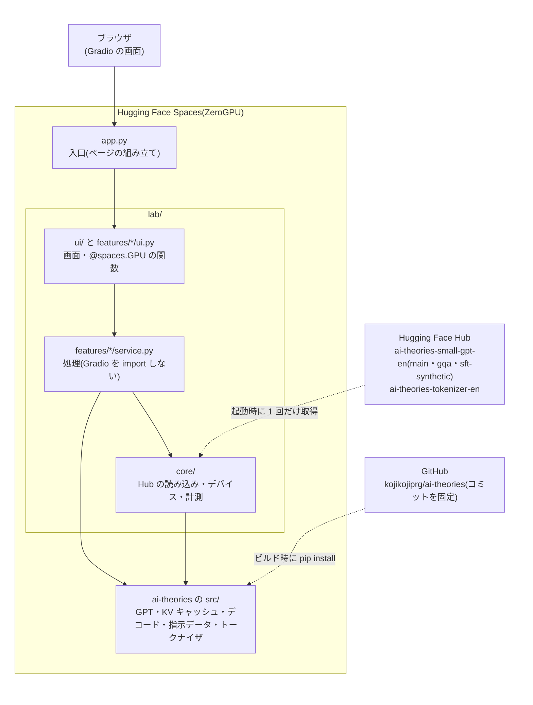

# AI Theories Lab

[ai-theories](https://github.com/kojikojiprg/ai-theories)の`theories/`で学んだ理論を、ブラウザで手を動かして確かめる **1 つの Web アプリ** です。スクラッチ実装した小型 GPT(Generative Pre-trained Transformer、英語、約 524 万パラメータ)を動かして、機能ごとにタブで試します。機能は、対応する理論のトピックが`theories/`にできてから、段階的に足していきます(計画は[`apps/README.md`](https://github.com/kojikojiprg/ai-theories/blob/main/apps/README.md))。Hugging Face Spaces の ZeroGPU で公開することを前提にしています。

- 研究・教育目的のモデルで、品質の保証はありません。ChatGPT のように会話できるモデルではありません。
- モデルが英語で学習しているため、入力は英語です。画面の文言は日本語を主とし、英語を併記しています。

## 1. 概要

現在の機能(段階 1)は次の 3 つです。

| 機能 | できること | 使うモデル(Hub のブランチ) |
|---|---|---|
| 文章の生成 | 英語の書き出しの続きを 1 トークンずつ逐次表示で生成する。デコードの方法(貪欲法・temperature・top-k・top-p・ビームサーチ)とその設定、KV キャッシュの有無、モデル(`main` / `gqa`)を切り替える。生成のたびに、生成したトークン数・時間・毎秒のトークン数を表示する。同じ入力・同じシードで、デコードの方法 2 つを並べて比べられる | `main`(標準の多頭注意機構)、`gqa`(Grouped-Query Attention) |
| モデルの中を見る | 英語の文を入れると、トークン分割(BPE の結合の過程を段階ごとに)・注意の重み(層とヘッドを選ぶ)・トークンごとの確率とエントロピー(位置を選ぶと上位の候補)を表示する | `main` |
| 指示への応答 | 016 の合成課題(英単語の列に対する 4 種類の操作)の指示に答える。見たことのあるテンプレートと未見のテンプレートを選べる。正解は規則で決まるので、完全一致したかを表示する | `sft-synthetic` |

## 2. 使用した理論

| トピック | このアプリでの使い方 |
|---|---|
| [001 注意機構](https://github.com/kojikojiprg/ai-theories/blob/main/theories/01_foundations/001_attention_mechanism.ipynb) | 「モデルの中を見る」の注意の重み。各層の注意機構が返す重みを、順伝播の途中で読み取って図にする |
| [005 トークナイザと部分語分割](https://github.com/kojikojiprg/ai-theories/blob/main/theories/02_pretraining/005_tokenizer.ipynb) | 「モデルの中を見る」のトークン分割。バイトレベル BPE が、学習した順位の高いマージ規則から順に語を結合していく過程を、段階ごとに表示する |
| [008 デコーディング戦略](https://github.com/kojikojiprg/ai-theories/blob/main/theories/02_pretraining/008_decoding_strategies.ipynb) | 「文章の生成」のデコードの方法(top-k・top-p のフィルタとビームサーチは`src/generation/decoding.py`のものをそのまま使う)。退化(Degeneration、同じ句の繰り返し)を、貪欲法と top-p を並べて見る。「モデルの中を見る」の、トークンごとの確率とエントロピー |
| [010 KV キャッシュと推論の計算量](https://github.com/kojikojiprg/ai-theories/blob/main/theories/03_efficient_training/010_kv_cache_and_inference_compute.ipynb) | 「文章の生成」の KV キャッシュの有無(`src/generation/cache.py`)と、`gqa`ブランチのモデル(Key / Value のヘッド数を減らした Grouped-Query Attention)。貪欲法では KV キャッシュの有無で生成結果が一致する |
| [016 SFT(指示チューニング)](https://github.com/kojikojiprg/ai-theories/blob/main/theories/04_alignment/016_supervised_fine_tuning.ipynb) | 「指示への応答」の合成の指示データ(`src/data/instruction.py`)、見たことのあるテンプレートと未見のテンプレート、終端記号までの貪欲法の生成と採点(`src/generation/stopping.py`) |
| [017 報酬モデルと RLHF](https://github.com/kojikojiprg/ai-theories/blob/main/theories/04_alignment/017_reward_model_and_rlhf.ipynb) | 「指示への応答」のモデル。017 が 016 の条件 1 のレシピで SFT し、LoRA をマージして`sft-synthetic`ブランチに上げたもの |

小型 GPT 本体は [006 小型 GPT の事前学習](https://github.com/kojikojiprg/ai-theories/blob/main/theories/02_pretraining/006_pretraining_small_gpt.ipynb) と [008](https://github.com/kojikojiprg/ai-theories/blob/main/theories/02_pretraining/008_decoding_strategies.ipynb) で事前学習したものです。

## 3. システム構成図



起動時に、トークナイザと 3 ブランチのモデルを同時にメモリへ載せます(重みの合計は約 59 MiB で、GPU のメモリにも余裕で載ります)。生成などの要求のたびに、`@spaces.GPU`を付けた関数の中で GPU が割り当てられ、終わると解放されます。

## 4. 使用技術・構成

- **バックエンド**: PyTorch。モデル・KV キャッシュ・デコード・指示データ・トークナイザは、`ai-theories`の`src/`をそのまま使う(GitHub のコミットを固定した git 依存)。
- **フロントエンド**: Gradio 6.30.0(`sdk_version`と`pyproject.toml`の固定を揃える)。注意の重みの図は matplotlib。
- **GPU**: ZeroGPU(`spaces`パッケージ)。ZeroGPU の外(手元の MPS(Metal Performance Shaders)や CPU)では`@spaces.GPU`は何もせず、同じ`app.py`がそのまま動く。デバイスは CUDA → MPS → CPU の順に自動で選ぶ。
- **Python・torch**: Python 3.12.12、torch 2.13.0(ZeroGPU の公式ドキュメントが対応を示す版)。
- **依存関係**: このディレクトリは独立した uv プロジェクト(`pyproject.toml`と`uv.lock`)。`requirements.txt`は uv からのエクスポート成果物で、手で編集しない。

### ディレクトリの構成

```
apps/ai_theories_lab/
├── app.py                      # 入口。各機能のページを組み立てるだけ(Space の起動ファイル)
├── pyproject.toml / uv.lock    # 独立した uv プロジェクト
├── requirements.txt            # uv.lock からのエクスポート(Spaces のビルドが使う)
├── README.md                   # このファイル(先頭は Spaces 用の YAML メタデータ)
├── lab/
│   ├── core/                   # 画面に依存しない共通部分(Gradio を import しない)
│   │   ├── artifacts.py        #   Hub からの読み込み、config.json からのモデルの構築、モデルの登録
│   │   ├── device.py           #   デバイスの選択、@spaces.GPU の装飾子(gpu)
│   │   └── timing.py           #   計測(同期を取り、画面の更新の待ちを除く)
│   ├── features/               # 機能ごとに、処理(service.py)と画面(ui.py)
│   │   ├── generation/         #   文章の生成(008・010)
│   │   ├── inspection/         #   モデルの中を見る(001・005・008)。図は figures.py
│   │   └── instruction/        #   指示への応答(016・017)
│   └── ui/                     # 共通の画面部品(components.py)・テーマ・リンク・ページの配置(layout.py)
└── tests/
    ├── conftest.py             # 乱数の重みの代替アーティファクトを用意する fixture
    ├── unit/                   # 常に走らせる(Hub を使わない)
    └── hub/                    # 本物の重みを使う。hub の印をつけ、既定では走らせない
```

**処理と画面の分離**: `service.py`は Gradio を import しません(`core/`も同じ)。段階 2 以降で API を足すときや、画面を差し替えるときに、処理の側をそのまま残すためです。この規則は、`tests/unit/test_architecture.py`が、import 文を調べて確かめます。

### 使っている Hugging Face Hub のアーティファクト

| リポジトリ | ブランチ | 内容 | 由来 |
|---|---|---|---|
| `kojikojiprg/ai-theories-small-gpt-en` | `main` | 事前学習済みの小型 GPT(RoPE・RMSNorm・SwiGLU、4 層、`d_model` 256、8 ヘッド、系列長 256) | 008 |
| `kojikojiprg/ai-theories-small-gpt-en` | `gqa` | Key / Value のヘッドを 4 に減らして追加学習した版 | 010 実験 D |
| `kojikojiprg/ai-theories-small-gpt-en` | `sft-synthetic` | 合成の指示データで SFT し、LoRA をマージした版 | 017 |
| `kojikojiprg/ai-theories-tokenizer-en` | `main` | 語彙 8,192 のバイトレベル BPE(Byte Pair Encoding) | 008 |

ブランチ名で取得するので、Hub 側でブランチが更新されると、再起動した Space は新しい重みを読みます。固定したい場合は、`lab/core/artifacts.py`の`ModelSpec.revision`をコミットのハッシュにします。

### 注意の重みの取り出し方(モデルの中を見る)

`src/`のモデルは、各層の注意機構(`MultiHeadAttention.forward`)が`(出力, 注意の重み)`を返し、`DecoderBlock`が受け取った後、`GPTLanguageModel.forward`が捨てています。そこで、`src/`を変更せず、各層の`self_attn`に **forward hook** を付けて、返り値の注意の重みを読み取ります(`lab/features/inspection/service.py`の`capture_attention`)。これは、モデルの中で実際に Value との積に使われた値そのもので、再計算した値ではありません。hook は値を読むだけで、順伝播の結果は変わりません。

次の確認を、`tests/unit/test_inspection_model.py`で行っています(`tests/hub/test_hub_inspection.py`で、本物の重みでも同じ確認ができます)。許容の誤差は、固定の値ではなく、float32 の丸めの単位と、足し合わせる要素数・値の大きさから導いています。

- hook を付けても付けなくても、順伝播の結果(logits)が bit 単位で一致する。
- 取り出した注意の重みと Value から、その層の出力を計算し直すと、その層が実際に返した出力と一致する(Grouped-Query Attention の Key / Value の複製も含む)。
- 取り出した注意の重みは、Query・Key(RoPE の適用後)から softmax で計算し直した値と一致する。

## 5. デプロイ手順

この機能は推論だけで、学習・評価を伴わないので、Google Colab は使いません。

### 5.1 手元での起動

Hub のモデルを取得するため、ネットワークが要ります(公開のリポジトリなのでトークンは不要)。このディレクトリで次の 1 コマンドを実行します。

```bash
cd apps/ai_theories_lab
uv run python app.py
```

表示された URL(既定は`http://127.0.0.1:7860`)をブラウザで開きます。初回は torch などの依存のインストールと、モデルの取得が入るため時間がかかります。

### 5.2 試験(pytest)

学習や重い計算はしません。

```bash
uv run pytest                        # tests/unit/ だけ。Hub を使わず、乱数の重みの代替アーティファクトで走る
uv run pytest tests/hub -m hub       # tests/hub/。Hub の本物のアーティファクトで走る(ネットワークが要る)
```

- `tests/unit/`の確認: 読み込み(3 ブランチを同時に載せる)・貪欲法で KV キャッシュの有無が一致・`GPTLanguageModel.generate()`および`beam_search()`との一致・008 の`generate_with_filter()`との一致・計測に画面の更新の待ちが含まれないこと・入力の検証・指示の組み立てと採点・`gradio_client`から`app.py`を呼ぶ確認・トークン分割と BPE の結合の過程が`encode_chunk()`と一致すること・注意の重みの取り出しの一致(上の 3 つ)・画面の表示用の整形・構成の規約(`service.py`が Gradio を import しない、`spaces`が torch より先に import される)。重みが乱数なので、**生成の中身やモデルの性能は何も確かめられません。**
- `tests/hub/`の確認: チェックポイントの SHA-256(017・010 のノートブックの記録との一致)、設定が 010 の`PROD_CONFIG`と一致、合成課題の完全一致率(見たことのあるテンプレートが 0.5 以上、未見のテンプレートが基準値 0.25 未満)、退化の例で貪欲法の 4-gram 重複率が top-p より高いこと、本物のトークナイザと本物の重みでの、注意の重みの取り出しの一致。

### 5.3 Hugging Face Spaces(ZeroGPU)へのデプロイ

**前提(無料枠)**: ZeroGPU の Space は、無料の個人アカウントでも **2 つまで** 作れます。条件は、メールアドレスが確認済みで、アカウントの作成から 30 日以上が経っていることです(PRO は 10 Space まで)。閲覧者ごとの 1 日の GPU の利用枠は、未ログインが 2 分、無料アカウントが 5 分、PRO が 40 分で、最初の GPU の利用から 24 時間後にリセットされます。この数値は、ZeroGPU の公式ドキュメント(https://huggingface.co/docs/hub/spaces-zerogpu、2026 年 10 月に確認)に基づくもので、変わりうるため、デプロイの前に最新の記載を確認してください。

1. Hugging Face で Space を新しく作る(https://huggingface.co/new-space)。名前は`ai-theories-lab`を想定する。SDK は **Gradio** を選ぶ。
2. **ハードウェアは README.md の YAML では指定できません。** 作成した Space の「Settings」→「Space hardware」で **ZeroGPU** を選びます(選択肢に出ない場合は、上の無料枠の条件を満たしているかを確認します)。
3. このディレクトリの内容を、Space のリポジトリへ push します。`ai-theories`と Space のリポジトリは別のリポジトリです。`ai-theories`のリポジトリのルートで、次のとおりにします。

   ```bash
   # 初回だけ: Space のリポジトリを remote として追加する(<user> は自分の値)
   git remote add space https://huggingface.co/spaces/<user>/ai-theories-lab

   # 初回の push: Space の側に初期のコミットがあるため、強制的に置き換える
   git push space "$(git subtree split --prefix=apps/ai_theories_lab HEAD)":main --force

   # 2 回目以降
   git subtree push --prefix=apps/ai_theories_lab space main
   ```

   push の認証には、書き込み権限のある Hugging Face のアクセストークンを使います(パスワードの代わりに入力する)。
4. Space のビルドが終わると、起動時に Hub からモデルとトークナイザを取得します(公開のリポジトリなので、Space にトークンは要りません)。「Logs」で、読み込みのエラーがないことを確認します。
5. 画面で、各タブの処理を 1 回ずつ実行して確認します。

**ZeroGPU 上での動作は、このリポジトリの作業の中では確かめていません**(Space を作成していないため)。初回のデプロイでは、次を確かめてください: 起動に失敗しない(`import spaces`の順序・モジュールの読み込み時のモデルの読み込み)、逐次表示が途切れず動く、速さの表示が出る、「モデルの中を見る」で、解析の後に層・ヘッド・位置を選び直しても動く(`gr.State`が`@spaces.GPU`の関数の出力・入力を通る)、「指示への応答」が答える。

### 5.4 ai-theories の版の更新

`src/`はコミットを固定した git 依存で持ち込んでいます(`pyproject.toml`の`[tool.uv.sources]`の`rev`)。`src/`を変更したときは、次の手順で固定するコミットを更新します。

1. `ai-theories`の変更をコミットして GitHub へ push する。**固定するコミットは GitHub から取得できる必要があります。** 作業のブランチのコミットでもビルドはできますが、そのブランチの削除や squash merge でコミットが参照されなくなると、取得できなくなりえます。`main`に入ったコミットを固定してください。**作業のブランチは、squash にせず通常の merge で`main`へ取り込み**、固定しているコミットを`main`の履歴に残します。
2. `pyproject.toml`の`rev`を新しいコミットのハッシュ(40 桁)に書き換える。
3. ロックとエクスポートを更新する。

   ```bash
   cd apps/ai_theories_lab
   uv lock
   uv export --format requirements-txt --no-hashes --no-dev --no-emit-project -o requirements.txt
   ```

4. `uv run pytest`が通ることを確認する。
5. `pyproject.toml`・`uv.lock`・`requirements.txt`をコミットし、5.3 の手順で Space へ push する。

Gradio の版を変えるときは、`pyproject.toml`の`gradio==...`と、この README の YAML の`sdk_version`を同じ値にします。

### 5.5 依存関係の注意

`ai-theories`の`pyproject.toml`が持つ依存(torch・torchvision・matplotlib・sentencepiece・numpy・huggingface-hub)が、そのまま Space のビルドに入ります。`uv.lock`に書かれた Linux x86-64 のホイールの大きさで見積もると、`requirements.txt`の全体は約 2.7 GiB で、そのほとんどは torch 本体(約 0.5 GiB)と、torch が要求する CUDA のライブラリ(nvidia-* と triton など、約 2.0 GiB)です。`ai-theories`の依存だけが持ち込むもの(torchvision・matplotlib・fonttools・kiwisolver・contourpy・pyparsing・cycler・sentencepiece)は、合計で約 21 MiB です。このアプリは、matplotlib を注意の重みの図に使い、sentencepiece は`src/data/tokenizer.py`がモジュールの先頭で import するため必要です(トークナイザの学習は使いません)。実際に import されないのは torchvision だけです。

版の衝突はありません。`ai-theories`が要求する`huggingface-hub>=1.28.0`は、Gradio 6.30.0 の`huggingface-hub>=1.16,<3`と両立し、2.2.0 に決まります。torchvision は torch と版が対になっているため、`pyproject.toml`で torch を`==2.13.0`に固定すると、torchvision も 0.28.0 に決まります。
